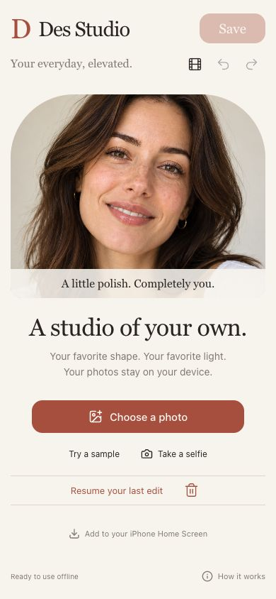
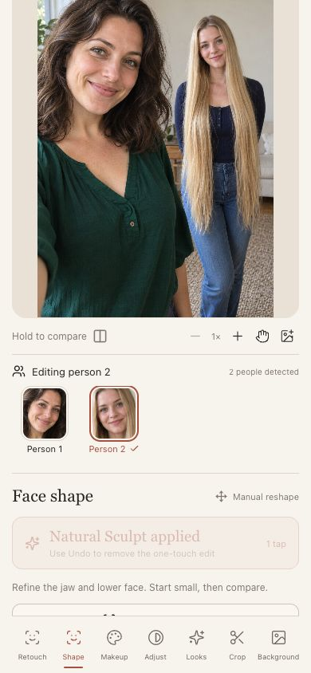
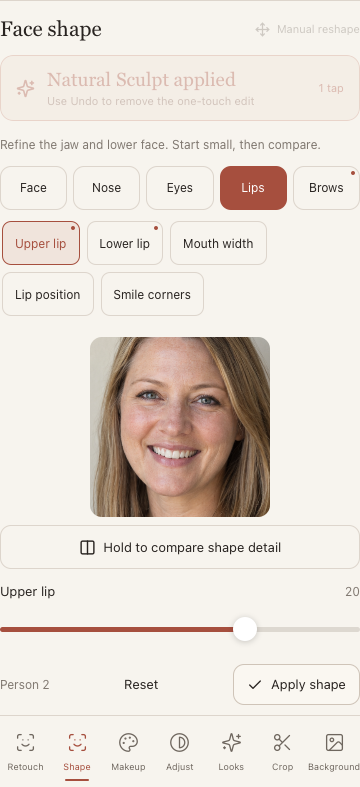
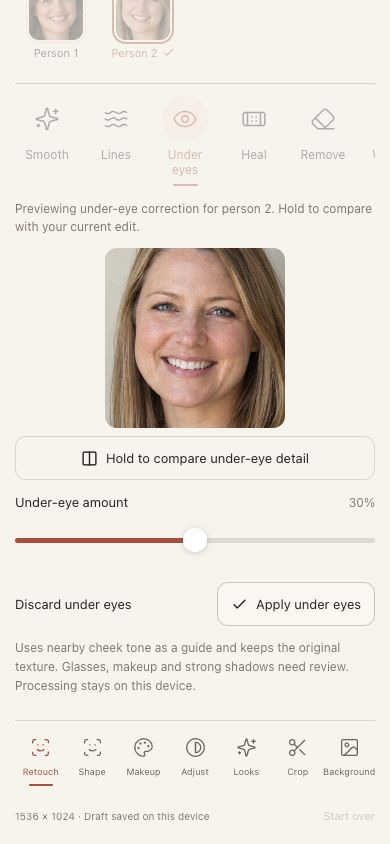

# Des Studio

[Open Des Studio](https://wassermanproductions.github.io/des-studio/)

This repository contains the finished browser application files used for free static hosting, plus documentation screenshots. The editable development source is kept separately and is not published here.

Photos, face detection and editing run on the user's device. This repository does not contain personal photos or editing drafts. The included sample portrait is a generated fictional image.

On iPhone, open the app in Safari and choose Share → Add to Home Screen. No Apple Developer subscription is required.

## Screenshots

Browser screenshots at phone-sized viewports using fictional sample portraits.

| Welcome | Choose a person |
| --- | --- |
|  |  |
| **Detailed reshaping** | **Under-eye correction** |
|  |  |

Google MediaPipe components retain their Apache 2.0 notice in `licenses/mediapipe-Apache-2.0.txt`.
